<p align="center">
  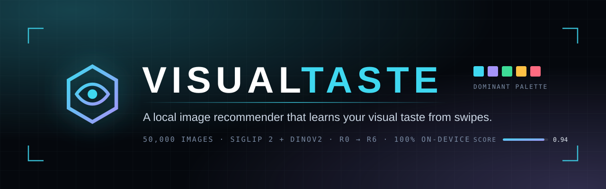
</p>

<p align="center">
  <a href="#quick-start"></a>
  <a href="#quick-start"></a>
  <a href="#architecture"></a>
  <a href="#the-interface"></a>
  <a href="https://github.com/not0aag/VisualTaste/actions/workflows/ci.yml"></a>
  <a href="#tests-and-quality"></a>
  <a href="LICENSE"></a>
</p>

<p align="center">
  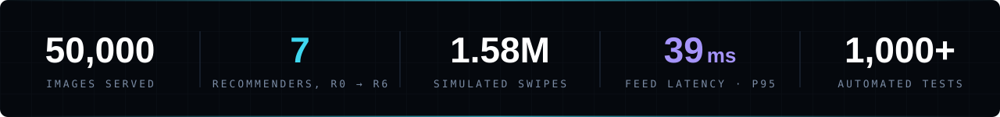
</p>

<p align="center">
  <b>VisualTaste starts out knowing nothing about what you like to look at.</b><br>
  You swipe through photographs; it learns your taste, finds the separate things you like,<br>
  explains every pick, and measures itself honestly. Nothing leaves your machine.
</p>

<p align="center">
  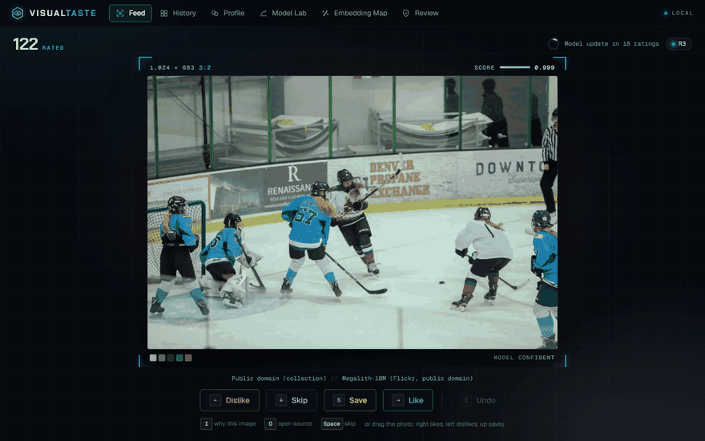
</p>

<p align="center">
  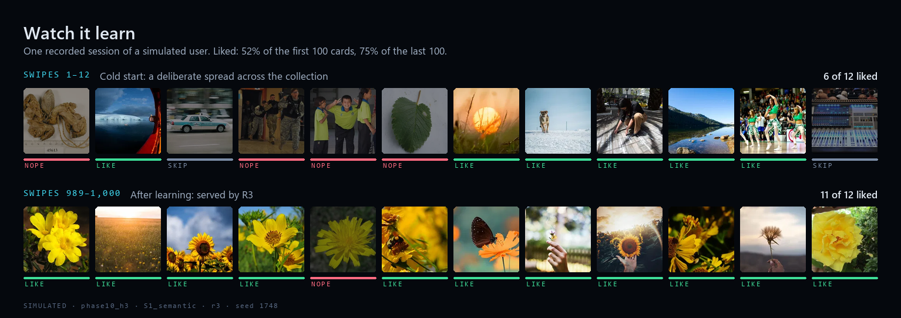
</p>

<p align="center">
  <sub>A recorded session of a simulated user with three hidden interests; by the end its feed has homed in on yellow flowers. Seed 1748 of 20; across all 20, the like rate rises from 50% in the first 100 cards to 65% in the last 100.</sub>
</p>

<p align="center">
  
</p>

---

## Contents

- [Highlights](#highlights)
- [The interface](#the-interface)
- [How it works](#how-it-works)
- [The recommender ladder, R0 to R6](#the-recommender-ladder-r0-to-r6)
- [Evaluation: what held up and what did not](#evaluation-what-held-up-and-what-did-not)
- [Engineering notes](#engineering-notes)
- [The image collection](#the-image-collection)
- [Quick start](#quick-start)
- [Operating it](#operating-it)
- [Repository map](#repository-map)
- [Learn the maths from the code](#learn-the-maths-from-the-code)

---

## Highlights

- **A full recommender stack, built up rung by rung.** Seven recommenders (cold start, Rocchio, FAISS kNN, logistic regression, Thompson sampling, multi-interest modelling and a neural ranker) share one interface. Each one is measured against the rung below it.
- **Two ways of seeing.** Every image is embedded by **SigLIP 2** (what it depicts) and **DINOv2** (how it looks). The models learn from both, and the Embedding Map puts the two spaces side by side.
- **Learns while you swipe.** The model retrains in the background every 20 ratings and hot-swaps atomically. A failed retrain keeps the old model, and two retrains never run at once.
- **Explores on purpose.** R4 draws from a Laplace posterior, so its uncertainty becomes exploration. It also diversifies each batch with MMR and probes the least-known corners of the collection. In simulation it finds every planted interest far more often than the greedy model does.
- **Explains every card.** Press `I` on any photo to see why it was shown: the reason, the score, and the liked images it resembles.
- **Measured honestly.** A planted-taste simulator, 20 seeds per arm, a paired bootstrap at 90%, sign tests, and verdicts written down whether they flatter the model or not.
- **Private by construction.** One FastAPI process bound to `127.0.0.1`, one SQLite file, no accounts, no telemetry, and no external requests from the app at runtime, fonts included.

---

## The interface

The app is a dark viewfinder built around one photograph at a time. Its details come from the photos themselves: the room takes on the light of the current image, and the frame carries readouts the way a camera's does.

These screenshots follow a **simulated user with six planted interests**, replayed from a recorded 1,000-swipe session, so you can see what the app makes of a varied taste.

<table>
  <tr>
    <td width="50%">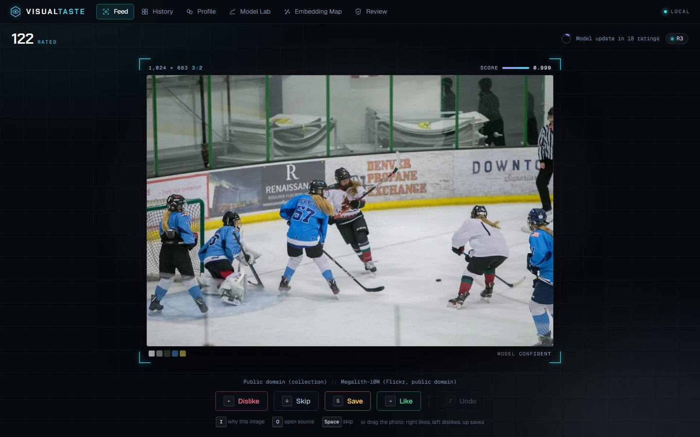</td>
    <td width="50%">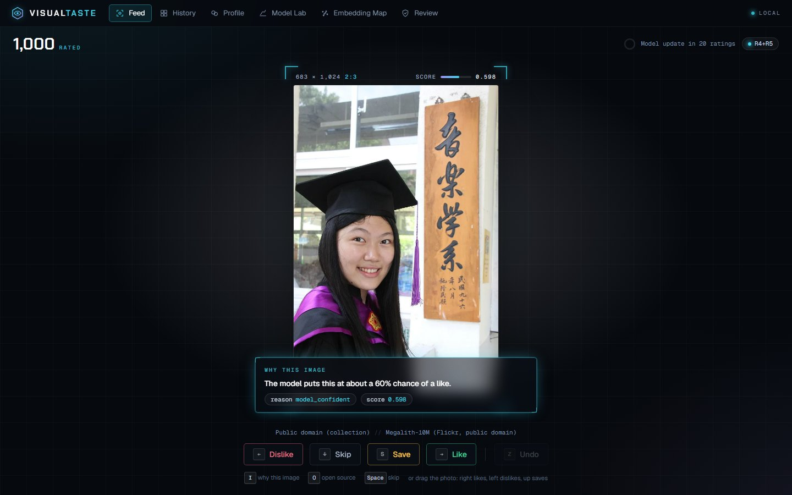</td>
  </tr>
  <tr>
    <td><b>Feed.</b> The frame shows the photo's real pixel size and aspect ratio, the model's score as a meter, the photo's five dominant colours, and why it was chosen. The ring at the top right counts down to the next model update.</td>
    <td><b>Why this image.</b> <code>I</code> opens the explanation: a plain sentence, the reason code and the score. Pressing a key also presses its on-screen button, and the screen's edge flashes in the verdict's colour.</td>
  </tr>
  <tr>
    <td>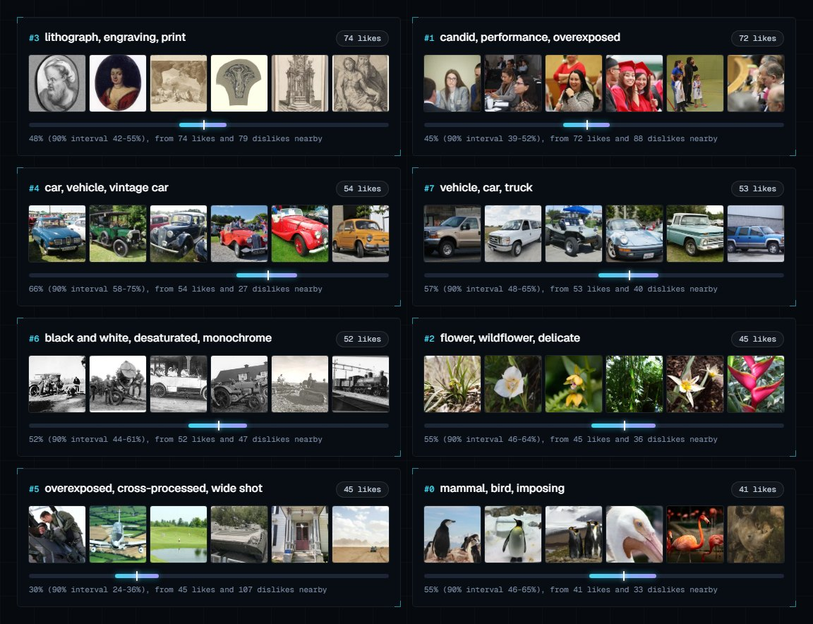</td>
    <td>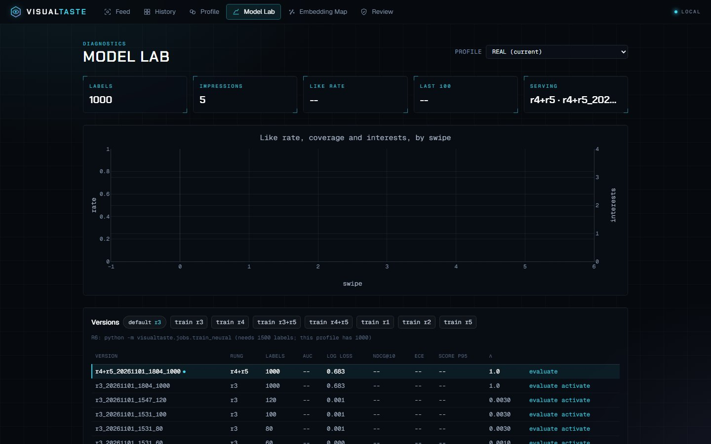</td>
  </tr>
  <tr>
    <td><b>Profile.</b> The separate interests found in your likes. Here the model found eight in the simulated user's 436 likes: lithographs, vintage cars, trucks, black-and-white photos, wildflowers, birds and more. Each card shows its six most central images, three concept words, and a 90% Beta interval on how often you like that area.</td>
    <td><b>Model Lab.</b> Like rate, coverage and interests on one timeline, with a marker wherever the serving model changed. Every trained version is listed with its metrics and can be evaluated, activated or A/B-tested by interleaving.</td>
  </tr>
  <tr>
    <td>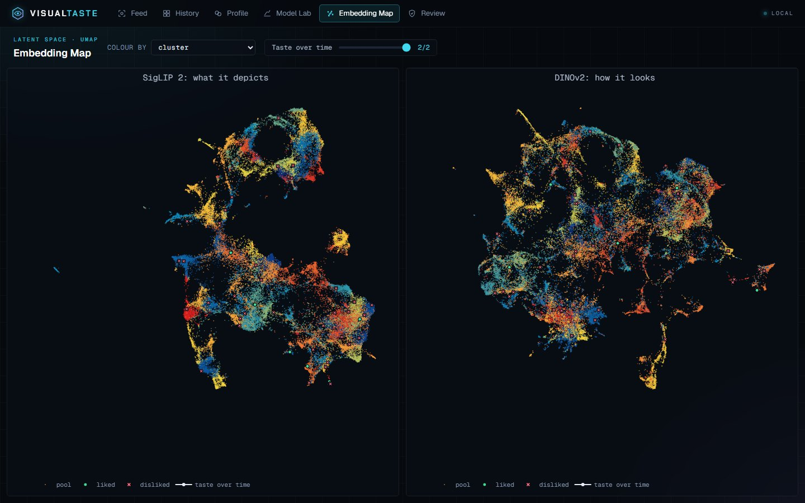</td>
    <td>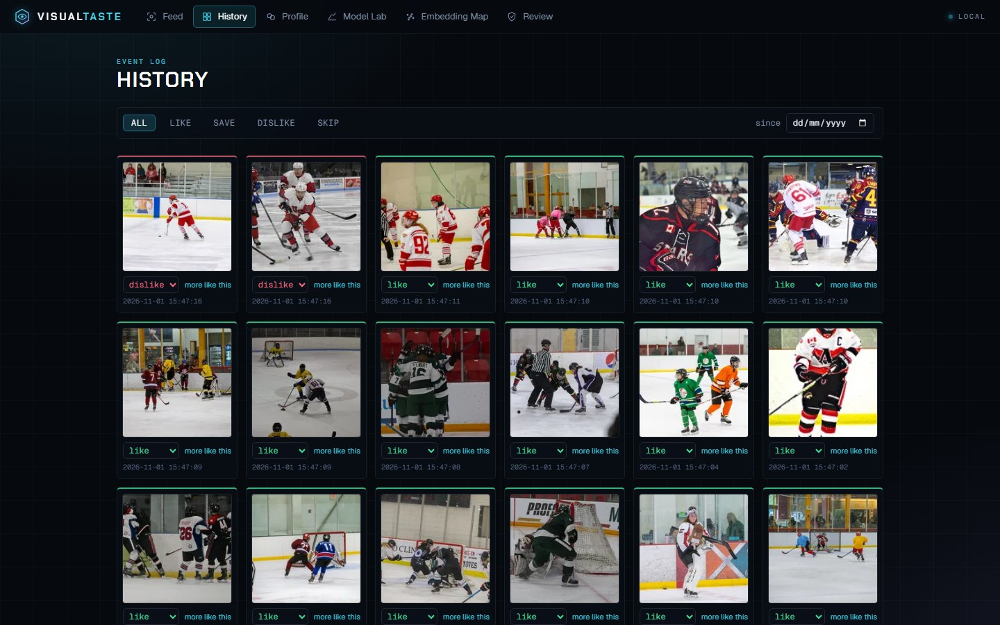</td>
  </tr>
  <tr>
    <td><b>Embedding Map.</b> All 50,000 images as UMAP points in both embedding spaces, coloured by cluster, source or current score. Your likes and dislikes are overlaid, and a slider walks your taste vector through time.</td>
    <td><b>History.</b> Every verdict as a contact sheet, with each tile's edge coloured by verdict. Change a verdict without rewriting the past (the old event is marked superseded), or ask for "more like this".</td>
  </tr>
</table>

<p align="center">
  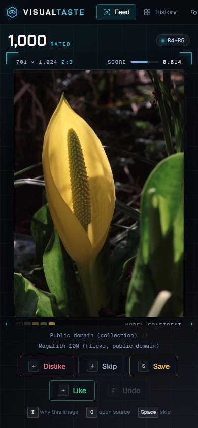<br>
  <sub>It works at phone width too. Drag the photo: right likes, left dislikes, up saves.</sub>
</p>

### Keyboard

| Key | Action | Key | Action |
| --- | --- | --- | --- |
| `→` or `L` | like | `S` | save |
| `←` or `J` | dislike | `Z` or `Backspace` | undo |
| `↓` or `Space` | skip | `I` | explain this image |
| | | `O` | open the original source page |

There is deliberately no infinite scroll, no count of what is left and no streak. The page asks one question at a time, because the labels are only as good as each judgement.

---

## How it works

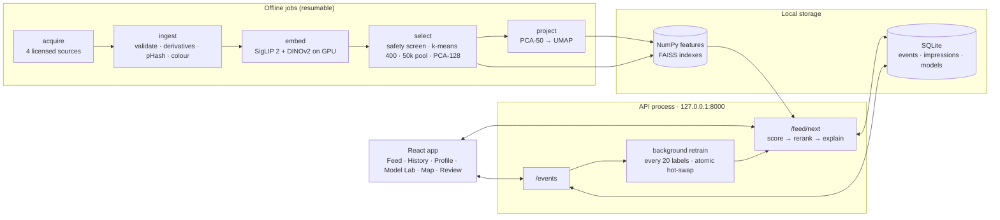

1. **Collect.** About 80,000 openly licensed images come from four sources. The licence gate is strict: an image with no licence URL is never written to disk. Originals are write-once.
2. **Clean.** Each image is fully decoded and checked (minimum size, aspect ratio, EXIF rotation, animated frames), then de-duplicated by perceptual hash and again by embedding similarity. A zero-shot safety screen, calibrated on 200 hand-checked images, quarantines borderline images for review.
3. **Embed.** Both encoders run on the GPU into float16 shards, then merge into unit-norm float32 matrices. Every job is incremental and survives being killed.
4. **Select.** k-means over 400 clusters caps any one look at 187 images, giving a balanced pool of 50,000 across 398 clusters.
5. **Serve.** Each request scores the whole pool in one matrix product, reranks for diversity and exploration, records impressions with their propensities, and returns five cards with explanations, in **39 ms at p95**.
6. **Learn.** Every 20 labels a background task retrains, validates and atomically swaps the serving model.

The full component diagram, the request path and the table-writer map are in [`docs/ARCHITECTURE.md`](docs/ARCHITECTURE.md).

---

## The recommender ladder, R0 to R6

Each rung answers a weakness of the one below it, and each is tested against it in the simulator.

| Rung | Idea | Why it is on the ladder |
| --- | --- | --- |
| **R0** · cold start | A deliberate spread across the collection's clusters | With no labels, the best move is to learn fast: show breadth, not guesses. |
| **R1** · Rocchio | Mean of liked vectors minus β × mean of disliked ones | The classic baseline: one direction of taste. Costs 7 ms at any label count. |
| **R2** · kNN | Top-5 cosine to likes minus 0.5 × top-5 cosine to dislikes, via FAISS | One direction cannot hold two tastes. kNN asks "is this near *something* you liked". |
| **R3** · logistic regression | L2-regularised, weighted, on standardised SigLIP + DINOv2 features. λ is chosen by time-ordered validation on every retrain. | Learns which *dimensions* matter and gives calibrated probabilities. Written once by hand in NumPy, then checked against scikit-learn to 1e-3. |
| **R4** · Thompson sampling | Laplace posterior over R3's weights, one Cholesky draw per batch, MMR rerank (λ = 0.7), and an exploration quota on the widest-Beta cluster | A greedy model narrows onto what it already knows. R4 turns uncertainty into exploration. |
| **R5** · multi-interest | k-means interests over your likes, log-sum-exp scoring, Hungarian matching so interest ids stay stable, and concept-word labels | Real taste is several separate things. R5 names them and can track each one. |
| **R6** · neural ranker | A per-block LayerNorm MLP trained with BCE + 0.5 BPR, as a 5-seed ensemble, with bootstrap Thompson sampling | A non-linear ranker for when labels are plentiful. It refuses to train below 1,500 labels and is never switched on automatically. |

R3 and R4 can also take R5's interest features (`r3+r5`, `r4+r5`). Interest features are computed time-respectingly, from strictly earlier likes only, and a dedicated test checks for leakage.

---

## Evaluation: what held up and what did not

A recommender that is only ever tried by its author proves nothing. VisualTaste ships a **planted-taste simulator**: synthetic users with hidden interests in the real 50,000-image pool, who react to what they are shown with calibrated probabilities. There are six scenarios:

| Scenario | The planted user |
| --- | --- |
| S1 · semantic | three interests defined by what images depict (SigLIP space) |
| S2 · appearance | three interests defined by how images look (DINOv2 space) |
| S3 · colour | interests defined by colour |
| S4 · conjunctive | likes only images that satisfy two conditions at once |
| S5 · drift | taste changes mid-session; can the model notice? |
| S6 · six interests | twice as many interests to find |

Every comparison is **paired** (the same simulated user meets every model), run over **20 seeds × 1,000 swipes**, and reported with a paired-bootstrap 90% interval and a sign test. The verdict is written down either way. So far that is **1,524 simulated sessions and 1.58 million swipes**.

| | Hypothesis | Result |
| --- | --- | --- |
| **H1** | Rocchio and kNN beat cold start | ✅ **Supported.** +0.138 and +0.161 like rate. Both find only 2 of 3 planted interests, though. |
| **H2** | Logistic regression beats kNN after about 150 labels | ❌ **Not supported for ranking.** R3 is better calibrated (lower log loss at every cut from 400 labels), but kNN ranks better (higher AUC at every cut from 150). |
| **H3** | Thompson sampling finds all interests faster than R3 | ⚖️ **Supported for discovery, at a price.** With six interests, the share of seeds where R4 finds all six rises by 85 points, it finds them about 770 swipes sooner, and it covers 58 points more of the collection. But it gives up 0.19 of like rate, failing the pre-registered bar of keeping 70% of R3's gain. |
| **H4** | Interest features improve R4 | ➖ **Inconclusive** on every metric and scenario. Named interests help explain the model, not rank. |
| **H5** | The neural ranker wins only once labels are plentiful | ❌ **Not supported.** Up to 4,900 labels, R6 never ranked better than R3+R5 (it was worse at 3,000 labels in both scenarios tested), and won on log loss only once. At this scale a neural ranker did not earn its cost. |

### What the simulator shows

The pure learner, R3, finds what you like quickly and then stops looking. In a world with six hidden interests it settles on about five and never finds the rest. R4 keeps the reach of a broad sweep while it learns.

<p align="center">
  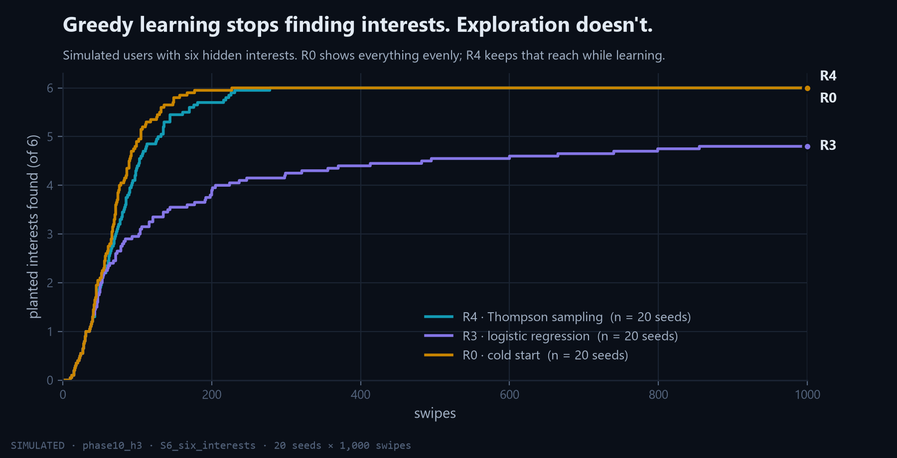
</p>

Each dot below is one simulated session. R3 buys its like rate by narrowing: in the last 500 cards it shows only 14 to 75% of the collection's clusters. R4 stays near 100%, and that coverage is what lets it find interests R3 never sees.

<p align="center">
  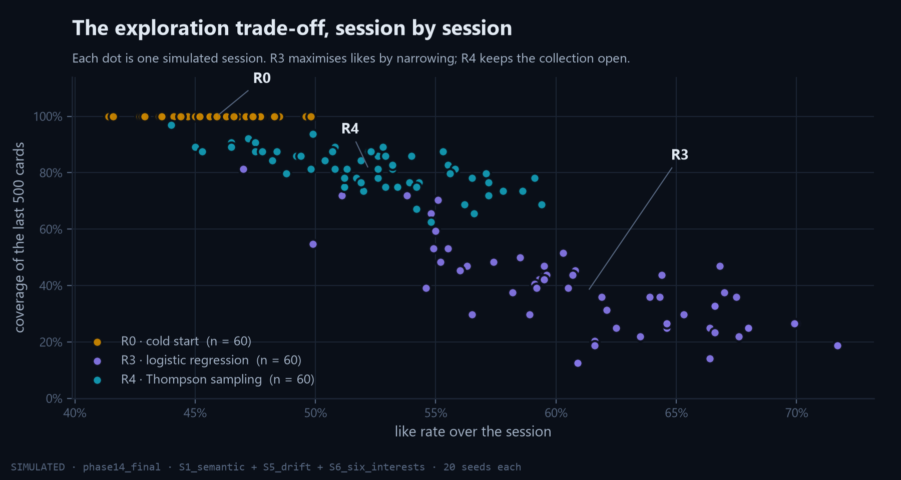
</p>

That reach has a price, and the simulator measures it without flattery. R4's like rate stays near the cold-start baseline, well below R3's.

<p align="center">
  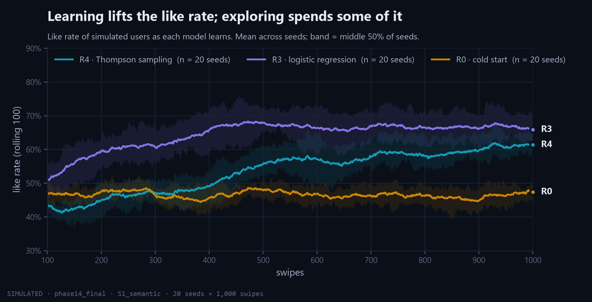
</p>

Making R4 keep more of R3's gain without losing its reach is the open problem: the exploration quota and the posterior temperature are the levers. The [sensitivity study](docs/EVALUATION.md) maps them.

Every number above, with per-seed tables, confidence intervals and the commands to reproduce it, is in [`docs/EVALUATION.md`](docs/EVALUATION.md). The 28 design decisions and their reasons are in [`docs/DECISIONS.md`](docs/DECISIONS.md).

---

## Engineering notes

Measured on an RTX 3060 Laptop GPU (6 GB) and a Ryzen 9 5900HX. Details in [`docs/BENCHMARKS.md`](docs/BENCHMARKS.md).

| What | Result |
| --- | --- |
| `GET /api/feed/next`, p95 | **39.4 ms**, down from 245 ms after removing a fancy-index gather from the request path |
| Scoring the pool | `(siglip @ u)[candidates]` takes **7.0 ms**, where `siglip[candidates] @ u` takes 58.5 ms. Gathering rows first copies 153 MB; the dot product streams the same memory once. |
| R2 kNN at 1,000 labels | 268 ms with FAISS against 608 ms with dense NumPy. That is why kNN is a measured rung, not the default. |
| Embedding throughput | 438 img/s (SigLIP 2) and 322 img/s (DINOv2) on synthetic tensors. On real files it is 41 and 54 img/s, because 83 to 91% of the time is JPEG decoding and disk IO, not the GPU. |
| UMAP of 50,000 points | 366 s (SigLIP 2) and 153 s (DINOv2) |

Other properties:

- **Every job is resumable.** Acquisition, ingestion, embedding and every simulator seed can be killed at any moment and continue where they stopped. This is tested by killing and resuming in the test suite.
- **Nothing is deleted.** Resetting a profile archives it, changing a verdict supersedes the old event, removals are recorded instead of erased, and a restore snapshots the database before overwriting it.
- **Backups.** A daily SQLite snapshot (14 kept) plus monthly append-only JSONL of every event.

### Tests and quality

| Suite | Count | What it covers |
| --- | --- | --- |
| pytest | about 1,000 | every rung's maths against hand-worked examples, NumPy vs scikit-learn agreement, Laplace covariance = H⁻¹, leakage tests, kill-and-resume, restore |
| Vitest | 50 | feed queue, dwell timer, Model Lab and Profile view models, viewfinder readouts, the in-browser demo server |
| Playwright | 11 | twenty keyboard swipes reaching the database, undo, attribution on every card, a smoke test per page with zero console errors |

`just check` (or `scripts/check.sh` / `scripts/check.ps1`) runs ruff, pytest, tsc, Vitest, the production build and Playwright: everything the build gates on. [CI](https://github.com/not0aag/VisualTaste/actions/workflows/ci.yml) runs the same on Ubuntu for every push, plus a dependency audit.

---

## The image collection

<p align="center">
  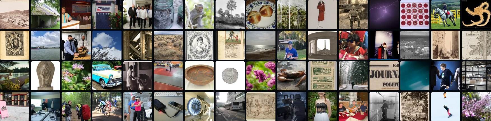
  <sub>One photo from each of the collection's 64 visual clusters.</sub>
</p>

| Source | Images | Licence |
| --- | --- | --- |
| [Megalith-10M](https://huggingface.co/datasets/madebyollin/megalith-10m) (Flickr) | 30,000 | public domain (collection-level) |
| [PD12M](https://huggingface.co/datasets/Spawning/PD12M) | 25,029 | CC0 / Public Domain Mark |
| [Open Images V7](https://storage.googleapis.com/openimages/web/index.html) | 15,002 | CC BY 2.0 |
| [Unsplash Lite](https://github.com/unsplash/datasets) | 10,005 | Unsplash Licence |

80,036 candidates came in, and 78,197 survived validation and de-duplication ([dataset card](docs/DATASET.md)). After a safety screen (789 auto-removed, about 1%) and a cluster-balanced selection, **50,000** are served, with no source above 50% of the pool. Every card in the app credits its photographer, licence and source page, and the backend refuses to store an image it cannot credit.

Images, embeddings and the database are **not** in this repository: they are regenerated by the jobs below.

---

## Quick start

Runs on Windows, Linux and macOS, and installs without administrator rights. A CUDA GPU is needed only to **build a collection from scratch** (embedding 80,000 images); everything else, tests included, runs on a CPU. CI runs the full suite on Ubuntu with CPU-only PyTorch on every push.

| Tool | Version | Notes |
| --- | --- | --- |
| [uv](https://docs.astral.sh/uv/) | 0.13+ | Windows: `irm https://astral.sh/uv/install.ps1 \| iex` · Linux/macOS: `curl -LsSf https://astral.sh/uv/install.sh \| sh` |
| Python | 3.12 | installed *by* uv |
| Node | 22 LTS | for the frontend |
| pnpm | 11 | `npm install -g pnpm` |
| NVIDIA driver | CUDA 12.x | only for building a collection; check with `nvidia-smi` |
| [just](https://github.com/casey/just) | optional | `just dev`, `just check`, `just study <name>` on any platform |

```bash
git clone https://github.com/not0aag/VisualTaste.git
cd VisualTaste

uv python install 3.12
uv venv --python 3.12

# PyTorch first and separately: the CUDA build with an NVIDIA GPU...
uv pip install torch torchvision --index-url https://download.pytorch.org/whl/cu128
# ...or the CPU build without one
# uv pip install torch torchvision --index-url https://download.pytorch.org/whl/cpu

# Everything else (exact measured versions are in requirements.lock)
uv pip install open_clip_torch timm transformers huggingface_hub faiss-cpu \
  numpy scipy pandas pyarrow pillow imagehash scikit-learn umap-learn \
  fastapi uvicorn pydantic pydantic-settings httpx boto3 tqdm typer \
  pytest pytest-asyncio ruff jupyter nbconvert matplotlib
uv pip install -e . --no-deps

# The frontend
cd frontend && pnpm install && cd ..
```

On Windows PowerShell, continue lines with a backtick instead of `\`, and the venv's Python is `.venv\Scripts\python.exe` rather than `.venv/bin/python`.

> **Use `uv pip install`, never `uv add`.** `uv add` re-resolves against PyPI and silently swaps the CUDA build of torch for the CPU one, which makes every embedding job about 30× slower.

Build the collection once (hours, mostly downloading; every step resumes if interrupted):

```powershell
python -m visualtaste.jobs.acquire                      # ~80k candidates from the four sources
python -m visualtaste.jobs.ingest                       # validate, derivatives, pHash, colour
python -m visualtaste.jobs.embed --model siglip2_b16_224
python -m visualtaste.jobs.embed --model dinov2_b14
python -m visualtaste.jobs.index                        # FAISS indexes
python -m visualtaste.jobs.select                       # safety screen, 50k selection, PCA-128
python -m visualtaste.rec.concepts                      # concept vocabulary for interest labels
python -m visualtaste.jobs.project                      # Embedding Map projections
```

Then run it:

```bash
just dev                 # or: ./scripts/dev.sh  ·  Windows: .\scripts\dev.ps1
```

The API listens on `127.0.0.1:8000` and the app on <http://127.0.0.1:5173>. `just check` (or `scripts/check.sh` / `scripts/check.ps1`) runs every linter and test the build gates on.

The first 30 ratings are cold start. Once there are at least 5 likes and 5 dislikes, the learned model takes over by itself and keeps retraining every 20 ratings.

---

## Operating it

<details>
<summary><b>Configuration</b></summary>

Copy `.env.example` to `.env` to override anything; every setting has a working default. The most useful is `VT_ARCHIVE_ROOT`, which puts the write-once originals and backups on an external drive.

</details>

<details>
<summary><b>Resetting the profile</b></summary>

**Profile → Reset profile…** starts a fresh profile. The old one is archived, not deleted: its events stay in the database under its old id, and Model Lab can still show it. Trained models are switched off, because they describe the old taste.

</details>

<details>
<summary><b>Training the neural ranker (R6)</b></summary>

R6 never trains inside the API. Once a profile has 1,500 labels:

```powershell
python -m visualtaste.jobs.train_neural --record
```

Then activate the new version in Model Lab.

</details>

<details>
<summary><b>Backups and restore</b></summary>

```powershell
python -m visualtaste.jobs.backup                    # back up now
python -m visualtaste.jobs.backup --list             # snapshots and their row counts
python -m visualtaste.jobs.backup --restore latest   # stop the API first
```

A restore snapshots the current database first, so it can be undone, and checks that the restored row counts match.

Backups are not encrypted: they sit on your own disk, next to the database they copy. If `VT_ARCHIVE_ROOT` points at a shared or synced drive, encrypt that drive or folder (BitLocker, FileVault, LUKS), since the event log is a record of your taste.

</details>

<details>
<summary><b>Re-running the simulator studies</b></summary>

Every study in `docs/EVALUATION.md` is one command, and every seed is cached under `data/eval/<study>/`:

```powershell
python -m visualtaste.jobs.evaluate --study phase9_rungs --seeds 20
python -m visualtaste.jobs.evaluate --study phase10_h3 --seeds 20
python -m visualtaste.jobs.evaluate --study phase14_final --seeds 20
python -m visualtaste.jobs.figures --study phase14_final
```

To run several in parallel without contending for SQLite's write lock, give each its own database copy:

```powershell
.\scripts\run_studies.ps1 -Database sim_b -Studies "phase10_h3:20:1000"
```

</details>

<details>
<summary><b>Measuring latency</b></summary>

```powershell
python -m visualtaste.jobs.latency --rungs r0,r1,r3,r4 --labels 0,100,1000,3000
```

This makes 500 real `/feed/next` requests per row and appends a p50/p95 table to `docs/BENCHMARKS.md`. The budget is p95 under 50 ms.

</details>

<details>
<summary><b>Adding a new embedding model</b></summary>

1. Add it to `vision/encoders.py` under a new `model_key`.
2. `python -m visualtaste.jobs.embed --model <key>`, then `python -m visualtaste.jobs.index`.
3. `python -m visualtaste.jobs.select --features-only` and `python -m visualtaste.jobs.project`.
4. Restart the API and retrain from Model Lab.

</details>

---

## Limitations

- **One person, on one machine.** There are no accounts and no multi-user model; the design assumes a single local profile.
- **Mostly evaluated in simulation.** A planted-taste user has a fixed taste over clusters of the embedding space. People drift, get bored and like things for reasons no embedding captures. The simulator compares models fairly; it is not evidence about any particular person.
- **The exploration trade-off is open.** R4 finds every interest but costs like rate; the `phase15_explore` study tests ways to narrow that gap.
- **The collection leans documentary.** Archive photographs and people at events are about 31% of it; prints, drawings and design about 9%. Details in [`docs/DATASET.md`](docs/DATASET.md).
- **Building a collection needs a GPU and hours.** Running the app, the tests and the simulator does not.

## Repository map

| Path | Contents |
| --- | --- |
| `backend/visualtaste/data/` | sources, licence gate, validation, derivatives, de-duplication, colour, safety screen, selection |
| `backend/visualtaste/vision/` | SigLIP 2 and DINOv2 encoders, sharded float16 vector store |
| `backend/visualtaste/rec/` | the R0–R6 recommenders, features, reranking, interests, concepts, model registry |
| `backend/visualtaste/eval/` | planted-taste simulator, replay, metrics, paired statistics, interleaving and IPS |
| `backend/visualtaste/api/` | FastAPI app, routes and background retraining |
| `backend/visualtaste/jobs/` | every offline job: acquire, ingest, embed, select, project, evaluate, figures, latency, backup |
| `frontend/` | Vite + React + TypeScript app |
| `notebooks/` | executed notebooks, one per maths unit |
| `tests/` | unit and integration tests, including the hand-worked maths examples |
| `docs/` | architecture, evaluation, benchmarks, decisions, learning path |

## Learn the maths from the code

The code is written to be read. [`docs/LEARNING_PATH.md`](docs/LEARNING_PATH.md) walks from cosine similarity to Thompson sampling, pointing at the exact functions, tests and simulator runs for each idea. It comes with executed notebooks:

| Notebook | Topic |
| --- | --- |
| [`01_vectors_and_cosine`](notebooks/01_vectors_and_cosine.ipynb) | cosine by hand, why normalised vectors make it a dot product, and what SigLIP 2 and DINOv2 each count as similar |
| [`02_rocchio_and_knn`](notebooks/02_rocchio_and_knn.ipynb) | Rocchio and kNN, and why one direction cannot hold two tastes |
| [`03_logistic_regression_by_hand`](notebooks/03_logistic_regression_by_hand.ipynb) | weighted, regularised gradient descent written out, then checked against scikit-learn |
| [`04_pca_and_umap`](notebooks/04_pca_and_umap.ipynb) | what the Embedding Map's axes do and do not mean |
| [`05_thompson_sampling_and_mmr`](notebooks/05_thompson_sampling_and_mmr.ipynb) | the Laplace posterior, Cholesky draws and diversity reranking |
| [`06_kmeans_and_interests`](notebooks/06_kmeans_and_interests.ipynb) | interests, log-sum-exp scoring and Hungarian matching |
| [`07_neural_ranker_and_backprop`](notebooks/07_neural_ranker_and_backprop.ipynb) | the R6 MLP, hand gradients against autograd, BPR |
| [`08_evaluation_metrics`](notebooks/08_evaluation_metrics.ipynb) | AUC, NDCG, ECE, the paired bootstrap and the sign test |

---

<p align="center">
  <sub>MIT licensed · images remain under their own licences, credited on every card · built and measured on one laptop</sub>
</p>
