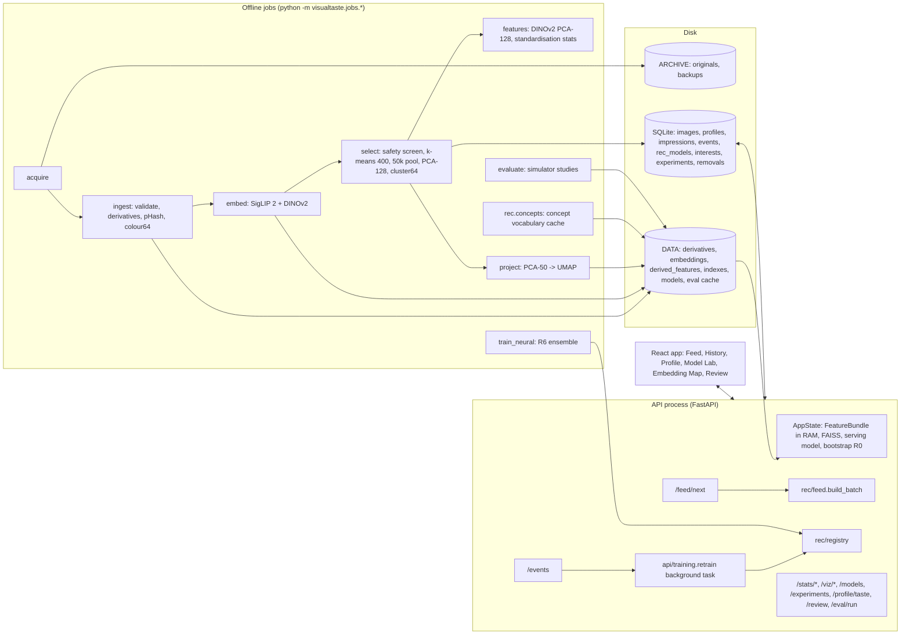

# Architecture

VisualTaste is one FastAPI process on `127.0.0.1:8000`, one SQLite database,
NumPy arrays held in memory, and a React app. Offline jobs (ingestion,
embedding, selection, projection, R6 training, simulator studies) run as
separate processes and communicate with the API only through files and the
database.

## Components and data flow



## The request path of `GET /api/feed/next`

1. `routes/feed.next_batch` reads the serving `(model, version)` pair under
   one lock (`AppState.serving`). An online retrain may swap both at any moment.
2. If an interleaving experiment is active, `rec/feed.build_interleaved_batch`
   team-drafts from both versions instead (Part 2 §6.4).
3. `rec/feed.build_batch`:
   1. If the model cannot serve (too few labels, one class, never fitted), the
      bootstrap R0 serves. The reason goes into every card's `fallback` field.
   2. `candidate_positions`: the pool minus every image this profile has an
      event for. The cost is proportional to the number seen, not the pool.
   3. `model.score(features, candidates)` is one matrix product over the whole
      pool, then indexed (F2, DECISIONS #13). If scoring raises, the batch falls
      back to R0 (Part 2 §4.4).
   4. Re-ranking: the model's own `rerank` hook when it has one (R4, R6:
      posterior or member draw, top-500 shortlist, probe quota, MMR, shuffle).
      Otherwise the plain top 5.
   5. One `Explanation` per card. Propensities: 1.0 for deterministic rungs,
      1/|unseen in cluster| for R0, estimated later for stochastic ones.
   6. `record_impressions` writes one `impressions` row per card, in one
      transaction, before the response.
4. After the response, a background task estimates R4/R6 inclusion
   probabilities from 200 replayed draws and updates those impression rows.
5. The response carries each card's attribution, reason, sentence, score and
   impression id. The client echoes the id back with the event.

Measured end-to-end latency is in `docs/BENCHMARKS.md` (`jobs/latency.py`).

## Where each table is written

| table | written by |
| --- | --- |
| `images`, `image_sources` | `jobs/ingest.py` (rows, status, pHash, colours); `jobs/select.py` (`selected`, `cluster64`, `cluster400`, quarantine); `routes/review.py` (status after review) |
| `embedding_models` | `jobs/embed.py` |
| `profiles` | `api/deps.ensure_profile`, `routes/profile.reset_profile` (ends one, starts one); `eval/sim.create_simulated_profile` (`is_simulated = 1`) |
| `impressions` | `rec/feed.record_impressions`; propensities by `rec/feed.write_estimated_propensities` |
| `events` | `routes/events.py` (insert, supersede, undo; never delete); the simulator's sessions (`eval/report.run_session`, `eval/study.run_interleaved_seed`) |
| `rec_models` | `rec/registry.register`, `set_active`, `deactivate_all`, `update_metrics`, via `api/training.retrain`, `routes/models.py` and `jobs/train_neural.py` |
| `interests` | `rec/r5_interests.persist_interests`, called by `api/training.retrain` for R5, R3+R5 and R4+R5 versions |
| `experiments` | `eval/interleave.start_experiment` and `finish_experiment`, via `routes/experiments.py` |
| `removals` | `routes/review.decide` |
| `embedding_errors` | `jobs/embed.py` |

## Dashboard traceability

Every number on every page, with the endpoint that serves it and where that
endpoint gets it. "Timeline" means `routes/stats.timeline`:

```sql
SELECT impressions.*, images.cluster64, <live event action>
FROM impressions JOIN images USING (image_id)
WHERE profile_id = ?
ORDER BY impression_id
```

### Model Lab (`pages/ModelLab.tsx`)

| number | endpoint | source |
| --- | --- | --- |
| labels | `GET /stats/summary` | `rec/labels.build_label_set` (latest non-undone event per image) |
| impressions | `GET /stats/summary` | `SELECT COUNT(*) FROM impressions WHERE profile_id = ?` |
| like rate, last 100 | `GET /stats/summary` | `eval/metrics.like_rate` over the timeline's actions |
| serving rung and version | `GET /stats/summary` | `AppState.serving()`; "r0" while the configured rung is unfitted |
| like-rate curve | `GET /stats/learning-curve` | `eval/metrics.rolling_like_rate` over the timeline's actions |
| coverage curve | `GET /stats/learning-curve` | distinct `cluster64` in the last 500 timeline rows, / 64 |
| interests curve | `GET /stats/learning-curve` | `interests JOIN rec_models`: count per version, stepped at `trained_on_events` |
| rung-switch markers | `GET /stats/learning-curve` | changes of `impressions.model_version` along the timeline, merged per rung (`lib/labModel.rungChanges`) |
| per-version AUC, log loss, NDCG@10 | `GET /models` | `rec_models.metrics_json`: `replay_*`, written by `POST /models/{v}/evaluate` (`eval/replay.replay`) |
| per-version ECE | `GET /models` | `metrics_json.ece`: `eval/metrics.expected_calibration_error` over that version's impressions joined to events, skips excluded |
| per-version score p95 | `GET /models` | `metrics_json.score_p95_ms`: 50 timed `model.score` calls over the pool |
| λ | `GET /models` | `metrics_json.lambda` from `LogisticRecommender.fit_report` |
| score distribution | `GET /stats/scores` | `np.histogram` of the serving model's scores over `candidate_positions` |
| current batch markers | `GET /stats/scores` | `impressions.score` of the profile's latest `batch_id` |
| batch diversity, novelty | `GET /stats/diversity` | `eval/metrics.intra_batch_diversity` per `batch_id`; 1 - max cosine to earlier batches |
| coverage (last 500) | `GET /stats/diversity` | as the coverage curve, at the end |
| calibration curve, ECE | `GET /stats/calibration` | `eval/metrics.calibration_bins` and `expected_calibration_error` over timeline rows from R3/R4/R6 versions with a verdict |
| exploration yield | `GET /stats/exploration` | `eval/metrics.beta_interval` of likes / verdicts, `reason = 'explore'` vs the rest |
| interleaving wins, losses, p | `GET /experiments` | `eval/interleave.result_from_impressions` over `impressions.experiment_id` and `arm`, sign test |
| profile list (SIMULATED switch) | `GET /profiles?include_simulated=true` | `profiles`, with `rec/labels.label_count` |

### Profile (`pages/Profile.tsx`)

| number | endpoint | source |
| --- | --- | --- |
| likes, dislikes, labels, serving rung | `GET /profile`, `GET /profile/taste` | `build_label_set`; `AppState.serving()` |
| interest cards: ids, labels | `GET /profile/taste` | serving model's `InterestTracker` (R5, R3+R5, R4+R5), else fitted on the fly from likes; labels from `rec/concepts.label_for` |
| six central images | `GET /profile/taste` | liked images assigned to the interest, sorted by cosine to its centroid |
| like count, Beta interval | `GET /profile/taste` | rated images assigned to their nearest interest: Beta(1 + likes, 1 + dislikes), 90% |
| taste in words | `GET /profile/taste` | `rec/concepts.describe` of the Rocchio vector (likes) and the disliked mean, as z-scores |
| interest history | `GET /profile/taste` | `InterestState.history`, from each recluster's Hungarian matching |

### Embedding Map (`pages/EmbeddingMap.tsx`)

| number | endpoint | source |
| --- | --- | --- |
| point positions | `GET /viz/projection` | `<DATA>/derived_features/umap2d_<model>.npy` from `jobs/project.py` |
| colour: cluster, source, score | `GET /viz/projection` | `images.cluster64`, `images.source`, the serving model's `score` |
| like, dislike and save overlays | `GET /viz/projection` | `build_label_set` actions |
| taste over time | `GET /viz/taste-path` | `rocchio_vector` of the first N labels, placed by `Projection.transform` (`umap.transform`) |
| interest markers | `GET /viz/taste-path` | serving model's interest centroids, placed by `umap.transform` |

### History and Review

| number | endpoint | source |
| --- | --- | --- |
| history grid, totals | `GET /history` | `events` joined to `images`, filtered and paged |
| "more like this" similarities | `GET /images/{id}/similar` | FAISS inner product (cosine) on the chosen model's index |
| review queue | `GET /review` | `images WHERE status = 'quarantined'` |